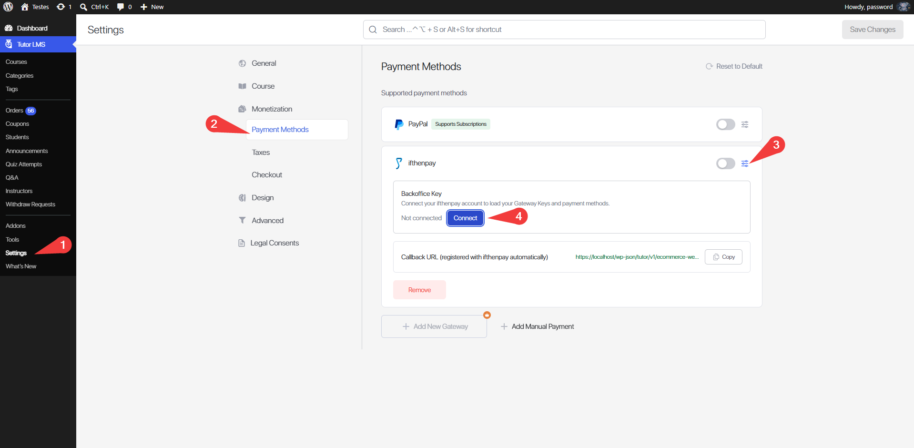
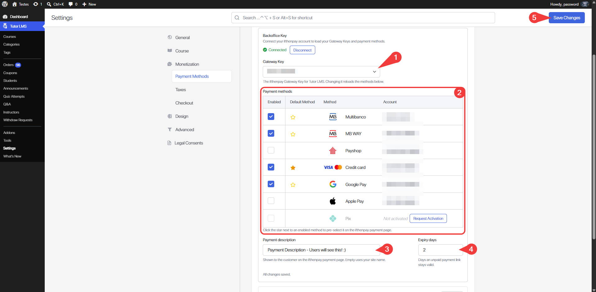
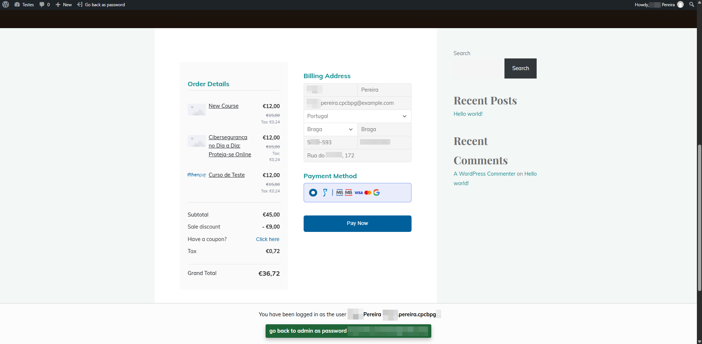
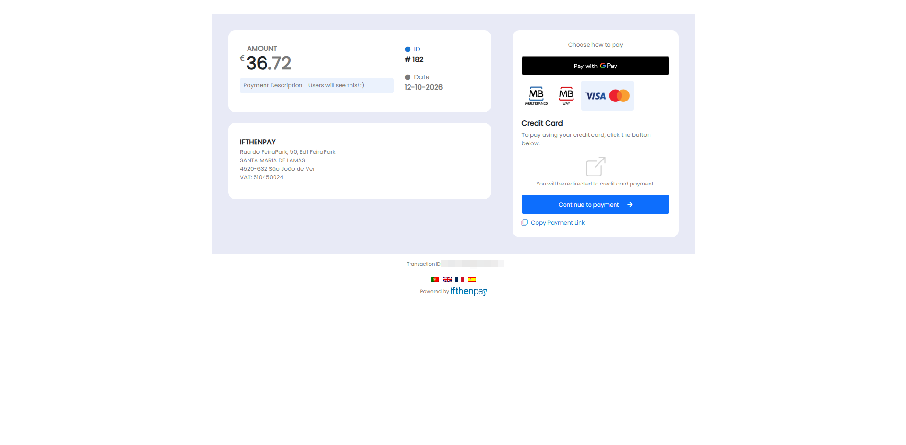
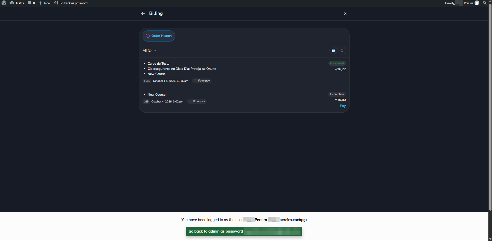
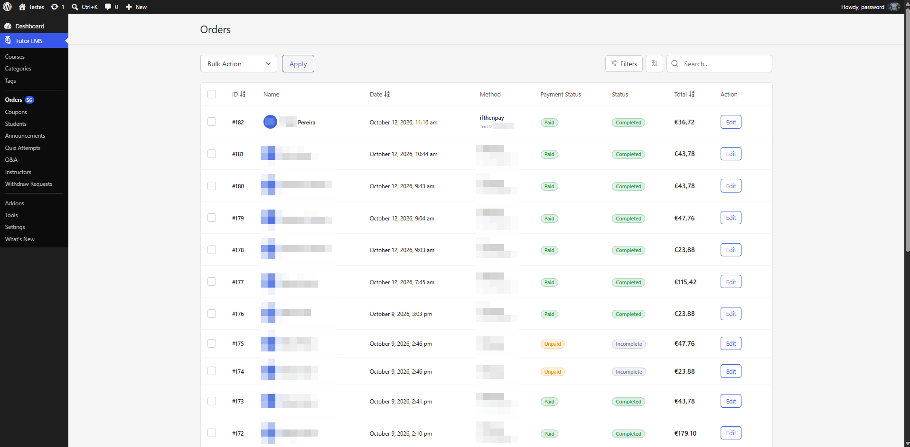

# ifthenpay | Payments for Tutor LMS

Adds ifthenpay to Tutor LMS's native checkout: cards, Apple Pay, Google Pay, Multibanco, MB WAY and more, through a secure pay-by-link page.

---

## Table of Contents

- [Description](#description)
- [Key Features](#key-features)
- [Requirements](#requirements)
- [Installation](#installation)
- [Checkout Setup](#checkout-setup)
- [Frequently Asked Questions](#frequently-asked-questions)
- [External Services](#external-services)
- [Screenshots](#screenshots)
- [Support](#support)
- [Security](#security)
- [Changelog](#changelog)

## Description

This plugin adds ifthenpay as a payment method in Tutor LMS's own eCommerce checkout. When a student buys a course, they're sent to ifthenpay's secure hosted payment page (Pay by Link) to pay with any method enabled on your Gateway Key. ifthenpay then calls your site back, the plugin checks the anti-phishing key and the amount, and Tutor LMS marks the order as paid and enrols the student. No card or bank details are ever handled or stored by your site.

### In plain terms you get:

- ifthenpay next to PayPal in `Tutor LMS → Settings → Payment Methods`
- A Connect button for your Backoffice Key, your Gateway Keys and a live payment methods table, all inside the ifthenpay card
- Automatic, callback-confirmed order status in `Tutor LMS → Orders`, with the method used and ifthenpay's request ID
- Offline methods (Multibanco, Payshop) supported: the order completes on its own once the reference is paid

All settings are made in Tutor LMS and in your ifthenpay Backoffice. The plugin is built so site owners can manage payments without needing deep technical knowledge.

## Key Features

1. Full integration with Tutor LMS 3.0+ native eCommerce checkout (one-time purchases)
2. Secure transactions
3. Automatic payment confirmation through ifthenpay's callback, with anti-phishing key and amount check
4. Support for multiple payment methods (Multibanco, MB WAY, Payshop, Credit card, Apple Pay, Google Pay, Cofidis Pay, Pix, Bizum)
5. Coupon and discount support via Tutor LMS (ifthenpay charges the order's final total)
6. Redirect to ifthenpay's secure hosted payment page, with your default method pre-selected
7. Real-time payment status in Tutor LMS orders, plus a success page that updates itself once the payment is confirmed
8. Multi-language payment page (English, Portuguese, Spanish, French)
9. Security first (no card data stored)

## Requirements

- An active ifthenpay merchant account — [subscribe here](https://ifthenpay.com/aderir/) to obtain your credentials.
- A Tutor LMS Gateway Key (request this from ifthenpay support/helpdesk).
- The payment methods you want enabled on that Gateway Key (our helpdesk team will guide you).
- WordPress 6.4+ and PHP 7.4+, and Tutor LMS 3.0+ installed and activated, with eCommerce (Monetization by Tutor) and the store currency set to EUR.
- HTTPS (SSL) enabled on your site.

## Installation

1. **Install:** Upload the plugin zip via `Plugins → Add New → Upload`, or install from WordPress.org and Activate.
2. **Credentials:** Ensure your ifthenpay account has an active Tutor LMS Gateway Key with the desired payment methods enabled.
3. **Setup:** Go to `Tutor LMS → Settings → Payment Methods`, expand the **ifthenpay** card, click **Connect** and enter your Backoffice Key.
4. **Gateway config:** Pick your Gateway Key. Next, choose which payment methods to activate from those available on that key, and star your default payment method. Finally, add a payment description, which is shown on the ifthenpay payment page for all transactions, and set how many days payment links stay valid. These save as you go.
5. **Activate:** Switch the ifthenpay card on and click **Save Changes**.

## Checkout Setup

- ifthenpay only shows at checkout once a Gateway Key and at least one payment method are enabled, and the Tutor LMS store currency is EUR. With another currency, the plugin shows an admin notice and keeps ifthenpay hidden.
- The checkout row shows the ifthenpay logo and the logos of your enabled methods.
- The callback URL is registered with ifthenpay automatically when you pick a Gateway Key, and re-registered if your site URL or permalinks change.

## Frequently Asked Questions

<strong>Does this plugin require Tutor LMS?</strong>

Yes. Tutor LMS 3.0 or newer, with its native eCommerce enabled, must be installed and active to use this plugin.

<strong>Does it support recurring payments?</strong>

No. This version supports one-time purchases only, so ifthenpay isn't offered on subscription plan checkouts.

<strong>Which currencies are supported?</strong>

Euro (EUR) only. With another store currency, ifthenpay is hidden at checkout.

<strong>Are payment details stored?</strong>

No. The plugin does not store card numbers or full bank details. The order only keeps the payment method and ifthenpay's request ID, which are needed for payment matching.

<strong>Does it support Tutor LMS coupons?</strong>

Yes. Tutor LMS applies coupons and discounts to the order first, and the payment link is created for the order's final total.

<strong>Which payment methods are supported?</strong>

Any ifthenpay method attached to your Gateway Key (e.g. Multibanco, MB WAY, Payshop, Credit card, Apple Pay, Google Pay, Cofidis Pay, Pix, Bizum). Methods not yet enabled on your key show a "Request Activation" button in the methods table.

<strong>How does the payment process work?</strong>

After the student places the order, they're redirected to ifthenpay's secure hosted payment page. Once the payment is made, ifthenpay calls your site back and the order is completed automatically. Returning from the payment page never marks an order paid by itself.

<strong>What happens with a Multibanco or Payshop reference?</strong>

The order stays unpaid until the reference is paid, and the student sees a "waiting for confirmation" message. Once ifthenpay confirms, the order completes and the student is enrolled.

<strong>What happens if a payment fails?</strong>

The order is not marked as paid and the student lands on Tutor LMS's order-failed page, from where they can check out again or choose another method. If the payment link can't be created, the reason is logged in the order's timeline in Tutor LMS → Orders.

<strong>Can I customize the payment experience?</strong>

Yes. You can choose which methods are offered, star a default method that's pre-selected on the payment page, set the payment description, and set how many days a payment link stays valid.

<strong>Is there a sandbox?</strong>

ifthenpay may provide test entities; if unavailable, use a low-value live test.

<strong>How secure is the integration?</strong>

Requests are encrypted over HTTPS; no sensitive payment data is stored. Callbacks are only accepted with the right anti-phishing key and the expected amount.

## External Services

This plugin integrates with the ifthenpay payment platform to process payments for Tutor LMS orders. ifthenpay is a third-party service that provides secure payment processing for card and digital wallet payments, bank references (Multibanco, Payshop), mobile payments (MB WAY, Bizum, Pix) and instalments (Cofidis Pay).

- **Tutor LMS**
  - **What it is and what it is used for**: Tutor LMS is a WordPress learning management plugin with its own eCommerce checkout. This plugin adds ifthenpay as a payment gateway in that checkout and confirms orders through Tutor LMS's own webhook route.

- **ifthenpay Backoffice & Integrations**
  - **What it is and what it is used for**: The ifthenpay Backoffice is the merchant dashboard used to manage integrations and payment configurations. The plugin uses the ifthenpay API (`api.ifthenpay.com`) to list your Gateway Keys and payment methods, generate payment links and register this site's callback URL.
  - **What data is sent and when**:
    - During setup: your Backoffice Key (to list your Gateway Keys) and a request for the public payment methods catalog. When you choose a Gateway Key: the Gateway Key, a generated anti-phishing key and this site's callback URL.
    - During payment processing: the Tutor LMS order ID, amount, payment description, the accounts of your enabled payment methods, the pre-selected method, the link expiry date, a one-time link flag, the page language and the success, error and cancel return URLs. No customer name, email or address is sent.
    - During callbacks (ifthenpay → your site): order ID, anti-phishing key, amount, payment method and request ID.
  - **End-User License Agreement (EULA)**: [EULA](https://ifthenpay.com/eula/)
  - **Privacy Policy**: [Privacy Policy](https://ifthenpay.com/politica-de-privacidade/)

- **Payment method activation requests (email)**
  - **What it is and what it is used for**: when you click "Request Activation" for a method that isn't enabled yet, an email is sent to ifthenpay support so they can enable it.
  - **What data is sent and when**: only when you click the button — your Backoffice Key, Gateway Key, the requested method, the site admin email, site URL and name, and your WordPress, Tutor LMS and plugin versions.

All network requests are performed server-side over HTTPS. Sensitive credentials are stored securely and are not publicly exposed; the Backoffice Key is never shown again in the admin screens. No raw card or bank details are stored.

## Screenshots

Below are screenshots demonstrating key features and interfaces of the plugin:

1. **(Admin Only) The ifthenpay card in Tutor LMS → Settings → Payment Methods**
   
2. **(Admin Only) Backoffice Key Connect modal**
   
3. **(Admin Only) Gateway Key and payment methods table**
   
4. **(Customers Experience) The ifthenpay row at checkout**
   
5. **(Customers Experience) ifthenpay's secure payment page**
   
6. **(Admin Only) A confirmed order in Tutor LMS → Orders**
   

## Support

For assistance use the [WordPress.org support forum](https://wordpress.org/support/plugin/ifthenpay-payments-for-tutorlms):

Pre-checks:

- Payment method enabled on Gateway Key AND mapped to Integration
- Tutor LMS store currency set to EUR
- Running current recommended versions of WordPress, PHP, & Tutor LMS

Commercial helpdesk available (no direct email required): [https://helpdesk.ifthenpay.com/](https://helpdesk.ifthenpay.com/)

- **ifthenpay support**: [suporte@ifthenpay.com](mailto:suporte@ifthenpay.com)
- **Tutor LMS docs**: [Tutor LMS docs](https://docs.themeum.com/tutor-lms/)

## Security

Found a security issue? Please report it privately to [suporte@ifthenpay.com](mailto:suporte@ifthenpay.com) with "Security" in the subject, rather than in the public support forum. See [SECURITY.md](SECURITY.md) for the full policy.

## Changelog

Releases that fix a security issue say so in their entry, prefixed with **Security:**.

### 1.0.0

- Initial release: ifthenpay Pay by Link gateway for Tutor LMS's native checkout, callback-confirmed orders, live payment methods table with activation requests.
